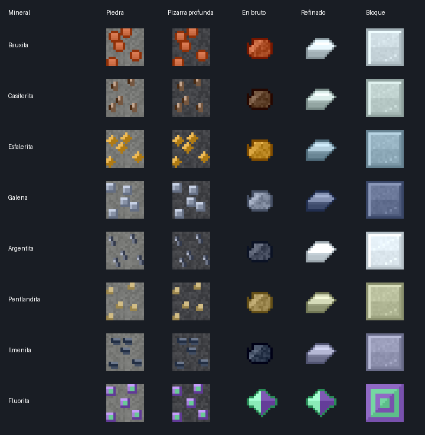

# Geología terrestre — 0.18.0 / Minecraft Fabric 26.1

El Overworld recibe ocho recursos geológicos reales, con 24 bloques, 15 materiales
y **39 texturas originales de 16 × 16 píxeles**. Se añaden las menas, sus versiones
en pizarra profunda y bloques de almacenamiento. Se conservan los minerales vanilla.



| Recurso | Composición de referencia | Producto | Altura Y | Intentos/chunk | Tamaño máximo de veta | Pico mínimo |
|---|---|---|---:|---:|---:|---|
| Bauxita | Roca rica en hidróxidos de aluminio | Aluminio | 32 a 128 | 8 | 12 | Piedra |
| Casiterita | SnO₂ | Estaño | 0 a 96 | 6 | 7 | Piedra |
| Esfalerita | ZnS | Zinc | −32 a 64 | 7 | 8 | Piedra |
| Galena | PbS | Plomo | −48 a 32 | 5 | 7 | Hierro |
| Argentita | Ag₂S | Plata | −56 a 16 | 3 | 5 | Hierro |
| Pentlandita | (Fe,Ni)₉S₈ | Níquel | −48 a 24 | 4 | 6 | Hierro |
| Ilmenita | FeTiO₃ | Titanio | −60 a 0 | 3 | 4 | Diamante |
| Fluorita | CaF₂ | Cristales de fluorita | −32 a 48 | 5 | 6 | Piedra |

La bauxita se limita a selvas y sabanas, incluidas sus variantes vanilla. Los demás
recursos se distribuyen entre los biomas del Overworld. La altura se selecciona
uniformemente; los intentos no garantizan una veta en cada chunk: hace falta roca
reemplazable y volumen disponible. La mena normal sustituye rocas del tag
`minecraft:stone_ore_replaceables`; la profunda sustituye las de
`minecraft:deepslate_ore_replaceables`. La bauxita aparece normalmente en piedra
por su intervalo de altura; su variante profunda también existe como bloque.

La dimensión Tierra `space_fabric:earth` utiliza los mismos biomas y generador
vanilla del Overworld, por lo que también recibe estos recursos. No se inyectan
en los biomas planetarios personalizados de Marte, Venus, la Luna o los gigantes,
ni en los biomas vanilla del Nether o End. Otros mods que reutilicen biomas del
Overworld también pueden heredar estas modificaciones de bioma, como es habitual
en Fabric.

## Texturas y minería

La bauxita muestra nódulos rojizos; la casiterita, prismas pardos; la esfalerita,
facetas de color miel; la galena, cristales cúbicos; la argentita, vetillas oscuras;
la pentlandita, grano bronceado; la ilmenita, placas azuladas; y la fluorita,
cristales zonados verdes y violetas. Los materiales en bruto, lingotes y bloques
también tienen sus propios PNG, sin depender de texturas de otros mods.

- Un pico insuficiente no obtiene recursos. El oro no sustituye al nivel de hierro.
- Las siete menas metálicas sueltan una pieza en bruto; la fluorita suelta un cristal.
- Fortuna usa la bonificación vanilla de minerales.
- Toque de Seda conserva la mena correspondiente, incluida la variante profunda.
- La fluorita concede 2–5 XP al minar mediante la implementación vanilla; los metales
  conceden XP al refinar. Toque de Seda evita la XP de minería.

## Refinado y almacenamiento

Cada materia prima metálica puede refinarse en un lingote mediante horno (200 ticks)
o alto horno (100 ticks), con 0,7 XP. También se pueden procesar las menas recogidas
con Toque de Seda. Nueve lingotes o cristales forman su bloque de almacenamiento;
un bloque devuelve nueve unidades, sin pérdida. Los bloques sirven para construir
y decorar. Hay 58 recetas con desbloqueo automático al obtener su ingrediente.

La selección de minerales se inspira en fuentes reales de los elementos, pero
**la fundición representa un refinado simplificado de Minecraft**: por ejemplo,
extraer aluminio o titanio de estas materias primas requiere procesos industriales
mucho más complejos en la realidad. Las vetas, alturas, rendimiento, dureza y colores
son decisiones de juego. La bauxita es una roca/mezcla, no una especie mineral única.
El nombre tradicional «argentita» se conserva para la mena de plata; a temperatura
ambiente la fase estable de Ag₂S es la acantita.

Esta versión añade recursos y bloques de construcción; no introduce herramientas,
armaduras ni un simulador de química industrial para estos metales.

## Instalación y comandos

Usa `space-fabric-0.18.0.jar` en cliente y servidor con Minecraft 26.1, Java 25 y
Fabric API. Sustituye el JAR anterior; evita cargar dos versiones simultáneamente.

**Las vetas aparecen en chunks generados después de instalar la actualización.**
Los chunks existentes mantienen sus bloques. No hace falta borrar el mundo:
explora terreno nuevo o crea un mundo de prueba.

Ejemplos:

```mcfunction
/give @s space_fabric:bauxite_ore
/give @s space_fabric:deepslate_ilmenite_ore
/give @s space_fabric:aluminum_ingot 64
/give @s space_fabric:fluorite_crystal 64
/give @s space_fabric:titanium_block
/locate biome minecraft:jungle
```

Todos están disponibles en la pestaña «Materiales del sistema solar». Los IDs de
las menas usan los nombres ingleses de la tabla de catálogo; consulta
[`earth_minerals.json`](../tools/earth_minerals.json).

## Código, personalización y verificación

- `earth/EarthMineral`: catálogo generado de minerales y parámetros.
- `earth/EarthMaterials`: registros de bloques, materias primas y productos.
- `worldgen/EarthOreGen`: inyección de features en los biomas correspondientes.
- `data/space_fabric/worldgen/{configured_feature,placed_feature}/earth_*.json`:
  objetivos de reemplazo, vetas, intentos y alturas.
- `data/space_fabric/loot_table/blocks/`: drops, Fortuna y Toque de Seda.
- `data/space_fabric/recipe/` y `advancement/recipes/earth/`: refinado y recetas.
- Tags de herramientas vanilla y tags `c:` de menas, lingotes, gemas y almacenamiento.

El catálogo de desarrollo está en `tools/earth_minerals.json`. Para reconstruir los
assets, datos y enum Java:

```sh
python3 tools/generate_earth_resources.py
python3 tools/validate_resources.py
./gradlew build --console=plain
# Vista previa opcional, requiere Pillow:
python3 tools/preview_earth_textures.py
```

Las pruebas usan los registros y codecs reales de Minecraft 26.1: verifican los
picos por nivel, loot válido, recetas ensambladas, desbloqueos, rocas objetivo y
la presencia/ausencia de las ocho features en los biomas modificados por Fabric.
La inspección visual en una partida y el muestreo de vetas sobre terreno generado
siguen pendientes; la imagen de arriba muestra los PNG utilizados por el mod.
