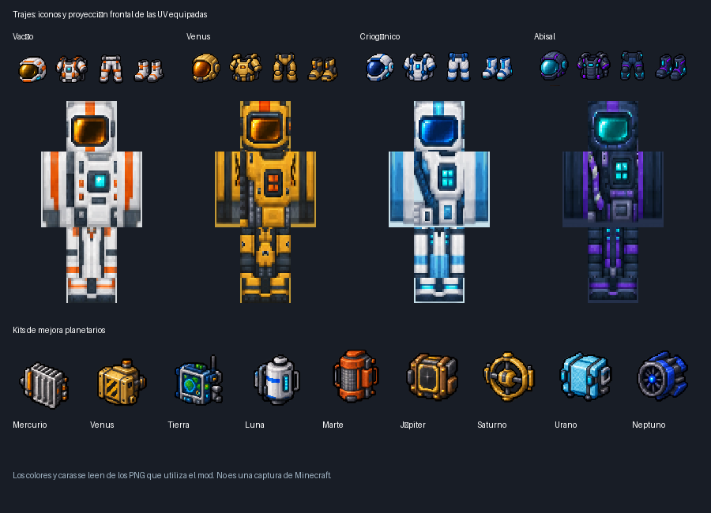

# Texturas de kits y trajes — 0.20.0 / Fabric 26.1

Los nueve kits de mejora tienen iconos propios, y los cuatro conjuntos de traje
incorporan iconos para sus cuatro piezas y texturas cuando se llevan equipados.
Se utilizan los mismos IDs, recetas y capacidades de las versiones anteriores.

La imagen muestra los PNG del mod y una proyección frontal de sus UV; **no es una
captura dentro de Minecraft**.

## Los nueve kits

| Destino | Icono del kit |
|---|---|
| Mercurio | Radiador plateado con aletas |
| Venus | Módulo de presión dorado con marcas oscuras |
| Tierra | Navegación azul/verde con pantalla |
| Luna | Depósito blanco de oxígeno con indicador azul |
| Marte | Filtro de polvo naranja |
| Júpiter | Blindaje de radiación en bronce |
| Saturno | Estabilizador de anillo dorado |
| Urano | Aislamiento criogénico cian |
| Neptuno | Estabilizador reforzado azul para tormentas |

Los iconos se muestran en el inventario, en el suelo y en el visor de recetas.
La instalación de kits conserva la misma mecánica de clic derecho sobre un cohete
vacío y detenido.

## Los cuatro trajes

| Conjunto | Apariencia |
|---|---|
| Vacío | Blanco/gris claro, detalles naranjas, visor dorado y panel cian |
| Venusiano | Dorado ocre, juntas oscuras, visor ámbar y placas térmicas |
| Criogénico | Blanco y azul hielo, detalles cian y visor azul |
| Abisal | Azul oscuro/grafito, bandas violetas y visor turquesa |

Desde 0.21.0 estos conjuntos pueden usarse en [espacios independientes](suit-slots.md)
junto con armadura normal.

Cada conjunto tiene casco, pechera, pantalones y botas. Las texturas equipadas usan
la geometría de armadura humanoide de Minecraft, con visores, paneles, juntas y
bandas colocados sobre sus caras. No se añade un nuevo modelo 3D de armadura ni
una superposición que tape la cámara.

`SuitMaterials` copia durabilidad, atributos, encantabilidad, sonido y reparación
del material anterior; cambia la clave visual del equipo. La protección contra
vacío, presión, temperatura y corrosión sigue dependiendo del conjunto completo
y de las reglas de [presión y trajes](pressure-and-suits.md).

Las piezas existentes normalmente adoptan la apariencia al actualizar, sin tener
que volver a fabricarlas. Componentes visuales personalizados añadidos manualmente
por comandos u otros mods pueden prevalecer sobre los valores predeterminados.

## Instalación y archivos

Sustituye el JAR anterior por **space-fabric-0.20.0.jar**, actualiza cliente y servidor
y reinicia. No hace falta regenerar terreno. En K → visor de recetas puedes buscar
`@space_fabric suit` o `@space_fabric rocket_kit` para ver los conjuntos y kits.

- `textures/item/*_rocket_kit.png`: nueve iconos de kits, 128x128.
- `textures/item/*_suit_*.png`: dieciséis iconos de armadura, 128x128.
- `equipment/{vacuum,venus,cryo,abyssal}_suit.json`: referencias nativas del equipo.
- `textures/entity/equipment/humanoid/*_suit.png`: casco, pechera, brazos y botas.
- `textures/entity/equipment/humanoid_leggings/*_suit.png`: cintura y piernas.
- Las ocho capas equipadas tienen 256x128 píxeles, con las proporciones de las UV 64x32.
- `tools/texture_sources/equipment/`: atlas y procedencia del arte.
- `tools/import_equipment_textures.py`: importación de iconos y distribución de UV.
- `tools/preview_equipment.py`: vista previa opcional con Pillow.

Los iconos utilizan exclusivamente el atlas de ítems. Las capas equipadas se
resuelven mediante los assets de equipo de 26.1, sin mezclar atlas ni alterar la
ruta de render del cohete.

## Verificación

`./gradlew build` ejecuta los codecs nativos de los cuatro assets de equipo,
comprueba los 25 modelos de inventario, tamaños, transparencia y cobertura de las
UV de casco, torso, brazos, piernas y botas. Las pruebas de los dieciséis ítems
verifican sus claves visuales, slots, durabilidad, atributos y reparación; las
pruebas previas conservan la comprobación de recetas y conjuntos de protección.
La inspección visual en una partida, con movimiento y optimizadores gráficos,
sigue pendiente. La vista frontal de UV no sustituye esa comprobación.
