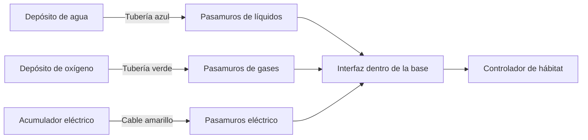

# Automatización industrial — 0.37.0

Instala `space-fabric-0.37.0.jar` en cliente y servidor con Minecraft 26.1,
Java 25, Fabric y Fabric API. Funciona en partidas existentes: todos los bloques
son fabricables y no requieren terreno nuevo. Sus diez recetas aparecen con **K**.

## Componentes

| Circuito | Conducción | Paso por la pared | Almacenamiento por bloque |
|---|---|---|---|
| Líquidos, azul | Tubería de líquidos | Pasamuros para líquidos | Depósito: 16.000 unidades |
| Gases, verde | Tubería de gases | Pasamuros para gases | Depósito: 16.000 unidades |
| Electricidad, amarillo | Cable de energía | Pasamuros eléctrico | Acumulador: 24.000 unidades |

La **interfaz de máquinas** conecta cualquiera de las máquinas coloniales a
estos circuitos. Su cara con el conector dorado apunta a la máquina; las otras
cinco caras admiten conducciones o depósitos. Los depósitos se conectan
directamente a las tuberías, sin necesitar otra interfaz.

Se transportan agua, refrigerante enfriado, oxígeno, hidrógeno, atmósfera
venusiana, dióxido de carbono, nitrógeno y energía. Una bombona o un cubo de agua
equivalen a **1.000 unidades de transporte**; una batería cargada, a **2.400 de
energía**. Los líquidos y gases son contenidos almacenados, separados de sus
recipientes. No se mezclan con otros tipos ni se convierten por conectar bloques.

## Montar la primera red sin abrir la base

1. Fabrica un depósito de agua, otro de oxígeno, un acumulador, sus conducciones,
   tres pasamuros y una interfaz. Necesitarás paneles presurizados, placas de
   compuesto y los materiales que muestra el visor de recetas.
2. **Haz clic con el pasamuros sobre un panel presurizado o compuesto**: lo
   sustituye directamente y devuelve el panel. No deja un hueco de aire entre
   ambos bloques. El eje del paso sigue la cara pulsada: en una pared lateral,
   cruza hacia dentro y fuera. Shift + clic conserva la colocación normal.
3. Coloca la interfaz con **Shift + clic sobre un lateral del controlador de
   hábitat**. Deja libre el bloque de ventilación encima del controlador.
   Con Shift + clic y mano vacía sobre la interfaz puedes cambiar la cara de
   destino; el mensaje indica hacia dónde busca la máquina.
4. Conecta las tres líneas desde sus depósitos, a través de los pasamuros,
   hasta las caras libres de la interfaz interior.
5. Abre la interfaz y añade **dos bombonas vacías y una batería descargada**.
   Se reutilizan en un circuito local con las entradas y salidas de la máquina.
6. Carga agua, oxígeno y energía en sus depósitos. La interfaz prepara los
   suministros del controlador automáticamente. El controlador sigue necesitando
   una habitación válida, reservas y buen estado para proteger al jugador.

Los pasamuros mantienen el cerramiento tanto abiertos como cerrados. Un clic
con mano vacía abre o cierra el flujo; una señal de redstone lo detiene.
**Las tuberías estrechas no sustituyen una pared:** dejar una en el hueco de un
panel provoca una fuga. Romper el pasamuros también invalida el cierre.

## Cargar y vaciar depósitos

Su panel tiene una entrada, una salida, el contenido exacto y dos controles:

- **Vaciar envases en el depósito:** coloca bombonas llenas, baterías cargadas
  o cubos de agua. Devuelve bombonas vacías, baterías descargadas o cubos vacíos.
- **Llenar envases desde el depósito:** coloca el recipiente vacío apropiado.
  Obtienes una bombona o batería llena; el agua también permite llenar cubos.
- **Cambiar contenido:** disponible solamente con el depósito vacío. Permite
  fijar el tipo antes de conectar una línea. El acumulador almacena solo energía.

Al vaciarse, un depósito conserva su tipo. Así una línea de oxígeno no pasa a
llevar hidrógeno cuando se agota su reserva. Varios depósitos conectados pueden
ampliar una misma reserva, pero deben tener el mismo contenido o estar sin fijar.
Si una red une tipos incompatibles, se detiene sin destruirlos: separa las
líneas con válvulas y vacía/reconfigura los depósitos que corresponda.

**Mantén físicamente separadas las líneas de gases distintos.** Los depósitos
del mismo canal también se conectan al tocarse. Por ejemplo, evita colocar un
depósito de hidrógeno pegado al de oxígeno. Agua y refrigerante enfriado también
necesitan circuitos independientes. Los tres canales de color diferente no se unen.

Los depósitos procesan un envase por segundo. Las tolvas pueden insertar por
arriba/laterales y extraer los envases de salida por debajo. Una salida llena o
una carga que no cabe completa pausa la operación sin consumir el recipiente.

## Automatizar las máquinas

La interfaz extrae suministros terminados de las salidas de la máquina y los
almacena en los depósitos conectados. Recupera sus envases, los llena desde la
red cuando hace falta y alimenta solo una receta por adelantado. No crea
bombonas ni baterías gratis: necesita la reserva inicial de envases vacíos.

| Máquina | Conexiones habituales |
|---|---|
| Controlador de hábitat | Oxígeno, energía y, en Venus, agua refrigerante |
| Electrolizador | Agua y energía de entrada; oxígeno e hidrógeno en líneas separadas de salida |
| Generador geotérmico | Agua de entrada y energía de salida; sigue necesitando lava debajo |
| Cargador solar | Energía de salida; conserva sus requisitos de sol y planeta |
| Colector atmosférico | Energía de entrada y atmósfera venusiana de salida; toma superior al aire libre |
| Separador de gases | Atmósfera venusiana y energía de entrada; CO₂ y N₂ por líneas separadas |
| Procesador de azufre | Energía y nitrógeno, o hidrógeno para recuperar ácido; cristales/condensado por inventario |
| Horno cerámico | Energía y CO₂ según receta; minerales por inventario y lava debajo |
| Unidad de refrigeración | Agua y energía de entrada; refrigerante enfriado en otro circuito de salida |
| Analizador | Energía por cable; muestras y tarjetas por inventario |

En modo **automático**, la interfaz considera los ingredientes presentes y usa
electrólisis de agua como operación predeterminada del electrolizador. Puedes
elegir otra receta con las flechas del panel, por ejemplo la electrólisis de CO₂.
Los iconos muestran sus ingredientes y producto; pasa el cursor para identificarlos.

Los materiales sólidos y productos como gemas o informes siguen en los
inventarios normales. Puedes usar tolvas dentro del recinto. La refinería de
combustible actual trabaja con sólidos y celdas de combustible, y conserva su
automatización por tolvas; estas tuberías no son una red general de objetos.
Para cargar el rover, llena sus bombonas y baterías desde los depósitos y utiliza
su inventario habitual. Desde **0.39.0** también puedes usar una estación de
servicio conectada a estas redes: [montaje](venus-colony-expansion.md).

La interfaz se puede pausar desde su panel o con redstone. Las máquinas
averiadas no reciben nuevos suministros; se pueden retirar productos ya terminados.
Los filtros, revestimientos, reparaciones, tiempos y recetas anteriores permanecen.

## Ejemplo de una fábrica autosuficiente de suministros

Arranca el generador sobre lava con agua y envases vacíos; su energía alimenta
el electrolizador. Este produce oxígeno e hidrógeno. Envía el oxígeno al depósito
de la base y conserva el hidrógeno en una línea distinta. El agua, oxígeno y
electricidad cruzan la pared por sus pasamuros y llegan al controlador interior.

El circuito recicla recipientes, pero **sigue consumiendo agua y materias primas**.
Las reservas internas del hábitat mantienen su escala anterior: el depósito mide
contenido transportado y el controlador muestra sus propios presupuestos de autonomía.

## Guardado, límites y diagnóstico

- Contenido y tipo de los depósitos, envases de las interfaces, selección de
  receta y controles se guardan. Recoge el depósito con pico de hierro o superior
  para conservar su contenido en el objeto; los envases de sus slots caen aparte.
- La red no mantiene inventario en tránsito. Una válvula cerrada, línea rota,
  salida llena o reserva insuficiente impide la transferencia completa.
- Se atiende un ciclo cada segundo con el servidor a 20 TPS. Se recogen primero
  los productos y después se abastecen los hábitats antes que los demás consumidores
  seleccionados. Se rotan los turnos en instalaciones grandes para repartir el trabajo.
- Cada componente admite hasta **128 bloques conectados**, contando depósitos y
  pasamuros. Se atienden hasta **64 interfaces por dimensión y ciclo**. Divide
  instalaciones mayores en redes independientes.
- Solo se inspeccionan chunks ya cargados; un componente que alcanza una zona
  desconocida se pausa. Las tuberías no son cargadores de chunks. No existe
  transferencia retroactiva al volver a cargar una zona.
- Un clic en la tubería muestra el tipo, tamaño y reserva de su red. Los paneles
  señalan falta de envases, materiales, depósitos, capacidad o conexión válida.

La implementación está en `transport/`; los modelos, texturas y recetas se
regeneran con `python3 tools/generate_transport_resources.py`. Las pruebas
comprueban bucles, límites, mezclas, descarga, envases, NBT, minería, menús,
prioridad y un ciclo con electrolizador y soporte vital reales. Los modelos se
interpretan por CPU. Queda pendiente observar una instalación completa dentro
del juego, su aspecto, los controles de redstone y el funcionamiento multijugador.

Desde **0.38.0**, estas redes también alimentan el intercambiador térmico y su
circuito de retorno de agua. Consulta [la refrigeración industrial](industrial-cooling.md).
