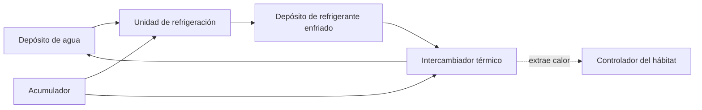

# Refrigeración industrial de Venus — 0.38.0

Requiere Minecraft 26.1, Java 25, Fabric y Fabric API. Sustituye el JAR anterior
en cliente y servidor. Todos los componentes son fabricables en partidas existentes;
no hace falta explorar chunks nuevos. El visor **K** muestra el intercambiador,
su receta de carga y la producción de refrigerante.

## Circuito de refrigeración

La unidad de refrigeración existente produce una bombona de **refrigerante
enfriado** a partir de una bombona de agua y una batería cargada, en diez segundos.
El nuevo **intercambiador térmico** carga una reserva de **4.800 unidades de frío**
con ese refrigerante y otra batería cargada, en tres segundos. Devuelve una
bombona de agua y una batería descargada. Los recipientes se conservan.

El intercambiador retira como máximo **120 unidades de calor por segundo**,
compartidas entre sus destinos. Solo consume frío cuando existe calor que retirar.
No procesa otra carga hasta agotar la anterior. Una salida bloqueada conserva
los ingredientes y pausa la carga. El frío ya almacenado sigue disponible.

El agua se recicla; la energía debe reponerse. Las dos operaciones consumen en
conjunto dos baterías por ciclo. No es un refrigerador de energía gratuita ni una
simulación termodinámica física: el agua retornada representa el refrigerante
usado que necesita enfriarse otra vez.

## Montaje

1. Fabrica el intercambiador con cuatro placas de compuesto venusiano, dos
   tuberías de líquidos, cobre, una unidad de refrigeración y una batería vacía.
2. Dentro de la base, colócalo **pegado por una cara al controlador del hábitat**.
   Deja libre la toma de ventilación encima del controlador. También puedes
   pegarlo a otra máquina que pertenezca a esa sala validada.
3. Añade una interfaz de máquinas junto al intercambiador, con el conector dorado
   orientado hacia él. Pon **una bombona vacía y una batería descargada** en la
   interfaz. Si automatizas la unidad de refrigeración, esta necesita otra
   interfaz con su propio juego de recipientes.
4. Conecta a la interfaz tres circuitos: refrigerante enfriado, energía y agua
   de retorno. Usa depósitos fijados al contenido correspondiente. **Separa
   físicamente agua y refrigerante**, aunque ambos usen tuberías azules.
5. Alimenta también la unidad de refrigeración con agua y energía; envía su
   producto al depósito de refrigerante. Las interfaces recogen automáticamente
   agua, refrigerante y baterías terminadas.
6. Usa los pasamuros sellados existentes para atravesar paredes. Las tuberías
   finas solas no sustituyen un panel presurizado.

Se admite carga manual: refrigerante en la primera entrada del intercambiador y
batería cargada en la segunda. Sus salidas son agua en la casilla 4 y batería
vacía en la 6. Tolvas e interfaces respetan esas mismas entradas y salidas.

Fuera de un hábitat validado, coloca el intercambiador **directamente junto al
equipo que quieras enfriar**. Si toca varios equipos, reparte sus turnos entre
ellos; 120 es el caudal total, no el caudal por vecino. Varios intercambiadores
pueden trabajar sobre un mismo destino sin consumir frío para calor inexistente.
Un intercambiador averiado por corrosión no carga ni entrega frío: conserva su
reserva para después de repararlo. Mantén filtros, revestimiento y energía.

## Calor y protección de la instalación

El balance térmico industrial se aplica a las máquinas coloniales en **Venus**.
Los bloques de otras familias, refinería, cohetes y rover mantienen sus sistemas
previos; el intercambiador no enfría entidades ni bloques vanilla.

En una sala sellada, las máquinas que tocan su volumen de aire o su cerramiento
comparten el balance de su controlador. Si hay controladores superpuestos, la
asignación usa un orden estable de posiciones. Conviene utilizar un controlador
por sala. Una sala rota o descargada deja de compartir refrigeración: un bloque
cercano al controlador por sí solo no pertenece a la sala.

El recinto recibe `8 + ceil(volumen / 16)` unidades de calor por segundo. El
controlador operativo aporta 16 unidades de enfriamiento básico mientras mantiene
su suministro anterior de agua y energía. Fuera de un recinto, cada máquina recibe
4 unidades ambientales y disipa 8. El calor adicional depende del trabajo real:

| Equipo que ha trabajado durante el segundo | Calor adicional |
|---|---:|
| Generador geotérmico | 30 |
| Horno cerámico | 40 |
| Electrolizador / separador de gases | 14 |
| Unidad de refrigeración | 12 |
| Intercambiador durante la carga | 6 |
| Analizador / colector / procesador de azufre | 8 |
| Controlador / cargador solar | 0 |

Un equipo con entradas insuficientes, salida llena o requisito ambiental inválido
no produce calor de trabajo. Las máquinas averiadas tampoco trabajan. Estos valores
son unidades de equilibrio de juego; no representan grados Celsius ni vatios.

- **7.000 / 10.000:** aviso de calor elevado en el panel y mensaje cercano.
- **9.000:** parada térmica de la industria asociada; conserva entradas y progreso.
- **5.000 o menos:** recuperación automática después de la parada.

La histéresis evita encendidos y apagados continuos junto al límite. El
intercambiador puede seguir cargando durante una parada térmica para recuperar la
instalación. El controlador mantiene el soporte vital mientras tenga habitación
válida, suministros y mantenimiento. Enfriar nunca concede protección frente a
presión, falta de oxígeno o fugas por sí solo.

El panel de cada máquina muestra el calor de su circuito; el intercambiador muestra
su reserva de frío. El controlador muestra calor y avisos; el indicador del hábitat
avisa de sobrecalentamiento sin confundirlo con una fuga. La temperatura regulada
del soporte vital sigue siendo su punto de consigna, no una lectura derivada de
estas unidades industriales.

## Guardado y comprobaciones

El calor local, la parada térmica y la reserva de frío se guardan en NBT. La
minería conserva esos valores y el mantenimiento en el objeto de máquina; su
inventario cae por separado. Las partidas anteriores comienzan con calor y frío
cero. No existe calentamiento ni enfriamiento retroactivo con la partida cerrada.
El servicio inspecciona máquinas ya cargadas y vecinos inmediatos; no fuerza chunks.
Se comparte el balance una vez por segundo del servidor, sin recursos en tránsito.

Las pruebas cubren umbrales, recuperación, saturación, generación de calor real,
reservas y recetas, salidas bloqueadas, ciclo de agua por interfaces, conservación
de recipientes, reserva persistente, datos de minería, menús y telemetría nativa.
Los modelos y materiales se interpretan por CPU. Queda pendiente observar el
montaje, sus controles y su aspecto en una partida real y en multijugador.
