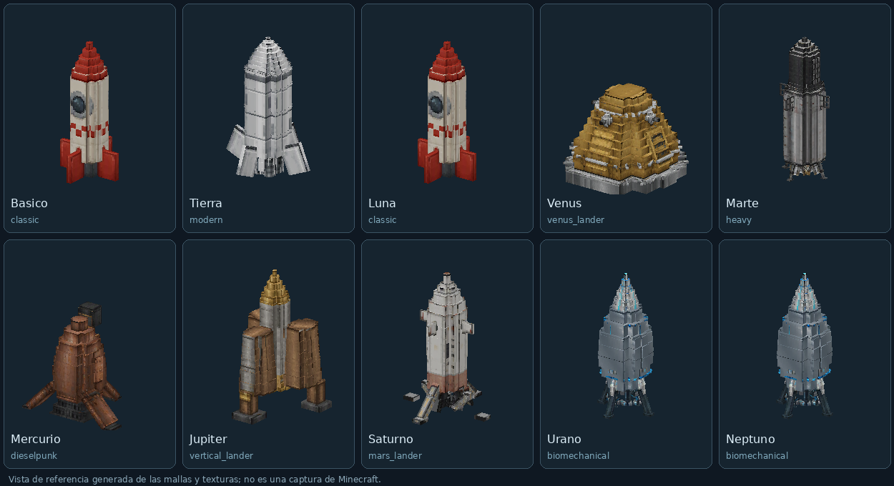

# Flota, niveles y combustible — 0.25.0 / Fabric 26.1

Desde 0.24.0, estos modelos realizan una [secuencia visible de viaje](rocket-journey.md),
con crucero espacial y descenso automático. Los niveles y consumos de esta guía
siguen vigentes.

Se usan ocho modelos suministrados para las diez variantes del mod. Se conservan
las texturas embebidas, UV de cada cara, pivotes y rotaciones de Blockbench.
**Todos muestran únicamente las piezas del archivo original**: se han eliminado
los collares, radiadores, jaulas, antenas y franjas de color añadidos por el mod.
Los ítems del inventario muestran la misma geometría 3D que las entidades.
Las patas, aletas y paneles incluidos en cada `.bbmodel` siguen formando parte
de su diseño. Algunas variantes comparten el mismo modelo original, sin retoques.

Vista calculada de los recursos incluidos, **no una captura dentro de Minecraft**.
Los modelos se escalan de forma uniforme y se apoyan por su punto más bajo.
Su caja de colisión se ajusta al modelo y cabe en las plataformas existentes.
La cabina interior funcional anterior se conserva como habitáculo común.

## Asignación

| Cohete | Modelo suministrado |
|---|---|
| Básico | space-rocket |
| Tierra | modern-space-rocket |
| Luna | space-rocket |
| Venus | venus-atmosphere-lander |
| Marte | two-stage-heavy-lift-orbital-rocket |
| Mercurio | dieselpunk-space-rocket |
| Júpiter | venus-vertical-landing-rocket |
| Saturno | mars-landing-rocket |
| Urano | biomechanical-exploration-rocket |
| Neptuno | biomechanical-exploration-rocket |

Los originales `.bbmodel` se guardan completos en `tools/import_sources/`.
Los nuevos modelos sustituyen la apariencia de Júpiter y Saturno, conservando sus
ítems, capacidades, protección, combustible y secuencia de viaje.

## Progresión

**Tierra (0) → Luna (1) → Venus (2) → Marte (3) → Mercurio (4) → Júpiter (5)
→ Saturno (6) → Urano (7) → Neptuno (8).** El básico también es de nivel 1.

Un cohete puede viajar a su nivel y a todos los anteriores. El nivel se comprueba
para **origen y destino**, en el servidor y en la interfaz; no basta con llevar
un cohete lunar a Neptuno para usarlo desde allí. Los bloqueos muestran el nivel
necesario y el que tiene el vehículo. El botón del mundo actual permanece bloqueado.
La Tierra separada y Overworld siguen siendo dos destinos distintos.

Esta es una progresión de juego, no una tabla de distancias actuales. Venus y
Mercurio están hacia el interior del sistema: acercarse al Sol también exige
cambiar la velocidad orbital. Las distancias entre planetas cambian continuamente.

Las protecciones ambientales son acumulativas: los modelos avanzados heredan
las de los anteriores. Siguen teniendo un límite de presión/temperatura: ningún
cohete permite bajar indefinidamente dentro de los gigantes gaseosos. La llegada
allí conserva las plataformas orbitales del mod.

La antigua opción `exclusive_destinations` deja de aplicarse; puede conservarse
el archivo antiguo, pero ya no restringe un cohete a un único planeta.

## Depósitos y consumos

Cada celda aporta **1000 unidades**. Los depósitos admiten celdas enteras; si no
cabe una celda completa, no se consume. La GUI muestra combustible actual/máximo,
el nivel del cohete y el coste del trayecto elegido. El consumo depende de la
ruta, no del número de veces que se pulsa el botón ni de la duración del ascenso.

| Cohete | Nivel | Modelo | Depósito | Tierra → destino | Destino → Tierra |
|---|---:|---|---:|---:|---:|
| earth | 0 | modern | 3000 | 200 | 200 |
| base | 1 | classic | 3000 | 1700 | 500 |
| moon | 1 | classic | 4000 | 1700 | 500 |
| venus | 2 | venus_lander | 6000 | 2000 | 2100 |
| mars | 3 | heavy | 8000 | 2500 | 1700 |
| mercury | 4 | dieselpunk | 10000 | 4100 | 3100 |
| jupiter | 5 | vertical_lander | 20000 | 4400 | 9500 |
| saturn | 6 | mars_lander | 24000 | 5700 | 8300 |
| uranus | 7 | biomechanical | 28000 | 7000 | 8200 |
| neptune | 8 | biomechanical | 32000 | 8600 | 10000 |

La tabla se obtiene del código con `./gradlew verifyRocketModules`, en
`build/reports/rocket-fleet.md`. Las columnas usan **Overworld** como Tierra de
salida/regreso; para el cohete terrestre, el otro extremo es la dimensión Tierra.
Para viajes entre otros planetas se calcula su propio presupuesto. Los depósitos
permiten la ida y vuelta de todas las rutas admitidas con el tanque lleno, pero
cada despegue sigue verificando el combustible que queda: no hay recarga gratuita.

## Qué toma de la física real

`RocketFuelBudget` usa radios orbitales medios en UA y velocidades de escape
aproximadas de los planetas. Referencias: [NASA Planetary Fact Sheet](https://nssdc.gsfc.nasa.gov/planetary/factsheet/)
y el modelo clásico de transferencia de Hohmann entre órbitas circulares coplanares.

Con `r1`, `r2` en km, `a=(r1+r2)/2` y `μsolar=1,32712440018×10¹¹ km³/s²`:

- Exceso de velocidad de salida: `abs(sqrt(μ*(2/r1-1/a))-sqrt(μ/r1))`.
- Exceso de llegada: `abs(sqrt(μ/r2)-sqrt(μ*(2/r2-1/a)))`.
- Salida del cuerpo: `hypot(velocidadEscapeOrigen, excesoSalida) + pérdidas`.
- Captura: `hypot(velocidadEscapeDestino, excesoLlegada) - velocidadEscapeDestino`.
- Se añade un presupuesto simplificado de aterrizaje. Tierra–Luna usa una
  aproximación local de 0,85 km/s de exceso, en vez de tratarla como otra órbita solar.

**Conversión al juego:** 100 unidades por km/s presupuestado, más una reserva
jugable para misiones largas: `200*abs(nivelOrigen-nivelDestino) +
100*max(0,max(niveles)-1)^2`. El resultado se redondea hacia arriba a 100 unidades.
Las pérdidas de lanzamiento y la reserva son parámetros de balance; las de Venus
son mayores que las de Marte. Por eso despegar de un gigante cuesta más que salir
de la Luna, y la ida y la vuelta no tienen por qué consumir lo mismo.

Las unidades **no son litros, kilogramos ni toneladas reales**. No se simulan
ventanas de lanzamiento, carga útil variable, ecuación de masas por etapas,
impulso específico de un motor, aeroasistencia detallada ni efemérides.
La plataforma de un gigante y los cohetes reutilizables son elementos ficticios
del mod. Esta aproximación ofrece una progresión jugable inspirada en la energía
orbital, no una reproducción de la cantidad de propelente de una misión real.

## Partidas existentes e instalación

Sustituye el JAR por **space-fabric-0.25.0.jar en cliente y servidor** y reinicia.
Se conservan IDs de ítems, variantes, carga, casco y combustible guardado. Los
vehículos existentes adoptan su nueva apariencia y capacidad, sin rellenarse.
No hace falta regenerar los planetas. Ningún depósito se reduce respecto de las
3000 unidades anteriores: la Tierra y el básico mantienen ese límite.

Para cambiar un vehículo, instala su kit con clic derecho sin ocupantes, detenido
y con espacio suficiente para el nuevo modelo. No se permite instalar un tanque
más pequeño si perdería combustible; no se consume el kit cuando falla.
Las recetas y los iconos de los kits siguen disponibles en el visor integrado.

## Archivos y comprobaciones

- `space/RocketVariant`, `RocketRules`, `RocketFuelBudget`: nivel, protección,
  depósito y consumo de rutas compartidos por GUI y servidor.
- `space/RocketHullGeometry`: dimensiones físicas generadas desde los modelos.
- `client/rocket/RocketFleetModel`: emisor de vértices con UV propias, sin depender
  de la caché de cubos de Sodium; `RocketRenderer`: selección por variante.
- `tools/import_rocket_fleet.py`: importa geometría y texturas, produce ítems y
  mallas de entidad. `generate_rocket_variants.py` lo ejecuta al regenerar kits.
- `tools/rocket_fleet_manifest.json`: modelo fuente, escalas y límites de los diez diseños.
- El generador y los recursos de módulos exteriores se han eliminado para que
  la regeneración no vuelva a añadir accesorios al casco.
- `tools/preview_rocket_fleet.py`: vista de referencia con Pillow y NumPy.

Las pruebas comprueban los niveles acumulativos, ambos sentidos de todas las
rutas, combustible suficiente para regresar, límites profundos, guardado de los
depósitos completos, datos de menú con el paquete nativo y rechazo de reducciones
que perderían combustible. El chequeo visual por CPU emite 42.672 vértices y
compara las rotaciones y UV con las clases nativas de ítems de Minecraft 26.1.
También comprueba que el número de cubos y caras coincida exactamente con el
original, que no haya tintes ni texturas de acento, y que las variantes que usan
el mismo archivo tengan la misma malla.
Los modelos de inventario usan un solo atlas y todas sus texturas existen.
La apariencia y los vuelos interactivos con Sodium dentro de una partida siguen
pendientes; las pruebas no arrancan una GPU ni sustituyen esa comprobación.
