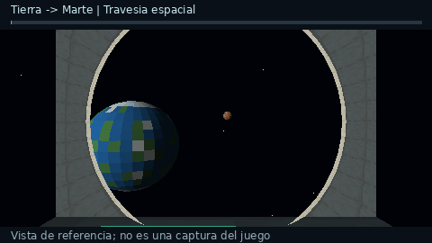

# Viaje visible del cohete — 0.24.0 / Fabric 26.1

El vuelo incluye despegue, travesía espacial y aterrizaje. Elige destino en el
mapa del cohete, carga el combustible indicado, sube y pulsa **Despegar** o Espacio.
No requiere activar una opción ni fabricar una pieza adicional.

Esta vista previa acelerada se genera de las mallas reales de la escena y la
cabina mediante un renderizador por CPU. **No es una grabación de Minecraft**;
solo muestra la fase espacial. La comprobación visual en partida sigue pendiente.

## Qué se ve

1. **Despegue:** el cohete asciende físicamente por la dimensión de salida con
   partículas de propulsión. Puedes ver el paisaje desde la cabina o con F5.
2. **Travesía:** al llegar a la altura orbital, un fundido da paso al vacío,
   estrellas y dos astros en 3D. El planeta de salida se aleja y el de destino
   aumenta de tamaño. La cabina permanece visible y puedes mover la mirada.
   En tercera persona se muestra tu modelo de cohete sobre el fondo espacial.
   Saturno tiene anillos y cada planeta tiene colores y bandas propios.
3. **Aproximación:** un fundido cubre el cambio de dimensión. El cohete aparece
   sobre una columna de aire libre, hasta 48 bloques por encima de la plataforma.
4. **Aterrizaje:** el piloto automático baja y frena al acercarse al suelo. Al
   tocar la plataforma vuelve al estado detenido y puedes desembarcar normalmente.

El HUD muestra origen, destino, fase y, durante la travesía, progreso y segundos
restantes. **F5** conserva su funcionamiento. En supervivencia, Shift no desmonta
al piloto mientras vuela, para evitar una caída accidental. Creativo y espectador
conservan su posibilidad de salir del vehículo.

## Duración y combustible

El crucero dura `240 + 60*abs(nivelOrigen-nivelDestino)` ticks: **12–36 segundos**
a 20 TPS. Tierra–Luna dura 15 s; Tierra–Marte, 21 s; Tierra–Neptuno, 36 s.
El ascenso y el descenso se suman a ese tiempo y dependen de la altura real.
Un servidor con TPS bajos tarda más en completar los mismos ticks.

Se paga el presupuesto del trayecto **una sola vez al despegar**, como en 0.23.0.
La escena no cobra combustible por fotograma, por segundo ni por fase; guardar,
volver a cargar o reintentar la transición no vuelve a cobrar el lanzamiento.
Los depósitos y costes de la [guía de la flota](rocket-fleet.md) se mantienen.

## Seguridad y guardado

El servidor controla fases, temporizador, posición y traslado; el cliente solo
presenta la escena y los datos recibidos. La cabina mantiene la protección
ambiental durante el breve desmontaje/remontaje nativo al cambiar de dimensión.

El aterrizaje comprueba una columna completa para que quepa el modelo. No abre
paso borrando techos o terreno. Si aparece un obstáculo durante el descenso, la
colisión detiene el cohete. Si no se encuentra lugar seguro en el destino,
regresa descendiendo sobre el punto de lanzamiento; el combustible del intento
se considera gastado y el regreso no cobra otra vez.

La fase, ticks, origen, duración y cota de aterrizaje se guardan junto a carga,
variante y combustible. Los guardados antiguos siguen cargando el cohete detenido.
Un vuelo iniciado que queda sin piloto se pausa en ascenso/crucero; se puede
volver a subir para continuarlo. El descenso puede completarse en piloto automático.
La reconexión real de jugadores y los vuelos multijugador requieren verificación
interactiva además de las pruebas de serialización.

## Alcance de la animación

La travesía es una **escena cinematográfica alrededor de la cámara del piloto**:
el vehículo permanece en la salida hasta la transferencia. No se añade una
dimensión espacial para explorar libremente, ni se simulan distancias o tiempos
astronómicos reales. Los otros jugadores conservan la vista normal del mundo.
Nubes, precipitación y niebla de la dimensión de salida se ocultan solo en la
vista del piloto durante el crucero y vuelven al finalizar esa fase.

El cambio de dimensión usa la API nativa con pasajeros. La generación/carga de
chunks puede mostrar la pantalla de carga de Minecraft, además del fundido; no
se garantiza ocultarla en todos los equipos. No se ha comprobado con GPU, Sodium
o paquetes de shaders en una partida real de este entorno.

## Implementación y validación

- `space/RocketJourney`: tiempos, interpolación, fundidos y frenado.
- `space/RocketEntity`: fases sincronizadas y persistencia de vuelos iniciados.
- `space/SpaceTravel`, `LandingPlanner`: columna libre y llegada con descenso.
- `space/RocketCabin`: protección ambiental durante la transición.
- `client/rocket/RocketFlightScene`: estrellas, esferas y anillos con vértices
  propios; `RocketRenderer` coloca esa escena detrás de la cabina y del cohete.
- `client/rocket/RocketFlightView`: HUD, progreso y fundidos del piloto.
- `mixin/RocketPassengerMixin`: cinturón de vuelo en supervivencia.
- `mixin/client/RocketFlightWeatherMixin`, `RocketFlightCloudMixin` y
  `PlanetFogMixin`: presentación espacial solo para el piloto.

`./gradlew build` comprueba duración, frenado sin sobrepasar el suelo, fundidos,
columna con obstáculos, guardado y recuperación de fases, conservación de
combustible y carga, aplicación de los Mixins y sus descriptores nativos.
`verifyRocketFlightScene` emite todos los destinos y cinco posiciones del crucero
con las clases nativas de vértices, verificando límites, luz y geometría sin GPU.

La vista previa se reproduce con `./gradlew exportRocketJourneyPreview` seguido
de `python3 tools/preview_rocket_journey.py` (Pillow y NumPy). Instala
**space-fabric-0.24.0.jar en cliente y servidor**; no hace falta regenerar terreno.
