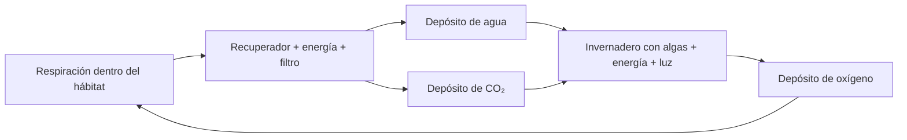

# Colonia, expediciones y aerostato de Venus — 0.39.0

Instala el JAR 0.39.0 en cliente y servidor con Fabric/Fabric API para Minecraft
26.1 y Java 25. Sustituye la versión anterior; no instales dos versiones juntas.
Los cinco bloques y el aerostato son fabricables en mundos existentes. Los tres
emplazamientos naturales aparecen en **chunks nuevos** de Venus. No se modifican
los edificios ya guardados ni los identificadores de las estructuras anteriores.

## Invernadero presurizado

El **módulo de invernadero** es una cámara hidropónica industrial. Fabrícalo,
colócalo dentro de una habitación con controlador operativo y conecta una interfaz
con agua y energía. Necesita nivel de luz **9 o superior** encima del módulo;
la **lámpara de cultivo**, luminancia 15, permite trabajar durante la noche.
No transforma una habitación abierta en un lugar respirable.

| Operación | Entradas, casillas 1 / 2 / 3 | Salidas | Tiempo a 20 TPS |
|---|---|---|---:|
| Trigo hidropónico | Semilla de trigo / batería cargada / agua | 2 trigos, 1 semilla, batería y bombona vacías | 20 s |
| Cultivo de algas | CO₂ / batería cargada / agua | Oxígeno, batería y bombona vacías | 20 s |

La semilla es un insumo real: se devuelve después del lote, en la quinta casilla.
Tolvas y clasificadores pueden devolverla a la entrada y retirar el trigo. La
interfaz mueve líquidos/gases/energía; las semillas y filtros se suministran por
inventario o tolva. Sin semillas, el modo automático elige algas; con semillas presentes, elige
trigo. Puedes fijar **algal_oxygen** mediante las flechas de la interfaz.

Las salidas llenas, la falta de luz, la pérdida del hábitat o una parada térmica
pausan la producción sin consumir las entradas del lote. Cambiar los ingredientes
reinicia el progreso. El calor industrial anterior también afecta al módulo.
La batería por lote representa la iluminación y circulación; la lámpara no tiene
un segundo consumo eléctrico independiente. Se producen alimentos como objetos;
no se fuerza el crecimiento de plantas vanilla en otras zonas del mundo.

## Recuperación de soporte vital

El controlador registra las unidades de oxígeno consumidas **por respiración**:
una por ocupante y segundo. Presurizar, ventear o intentar arrancar sin suministros
no crea residuos recuperables. Guarda hasta 9.600 unidades de respiración en el
mundo; no son un inventario transferible al recoger el controlador.

El **recuperador de soporte vital** debe pertenecer a esa habitación operativa.
Por lote consume **4.800 unidades de respiración**, dos bombonas vacías en la
primera entrada, batería cargada en la segunda y un filtro contra gases corrosivos
en la tercera. En diez segundos devuelve agua, CO₂, batería vacía y filtro gastado.
Las interfaces recuperan los envases y conectan los productos a sus depósitos.

El oxígeno resultante aporta **2.400 unidades** al controlador: recupera como
máximo la mitad de las 4.800 consumidas, antes de costes de presurización. El
circuito necesita oxígeno de reposición, filtros y energía. No produce oxígeno
ilimitado por colocar plantas. Las fuentes atmosféricas externas de CO₂ siguen
siendo utilizables, pero también requieren agua y energía para cultivar algas.

Cada controlador conserva sus residuos; dos recuperadores compiten por la misma
reserva y no pueden gastarla dos veces. Una salida bloqueada no consume residuos.
No basta una máquina próxima: la pertenencia usa el cerramiento validado del hábitat.

## Estación de servicio

Coloca la **estación de servicio** en la zona de aparcamiento. Empieza apagada:
**Shift + clic derecho con mano vacía** activa/desactiva el servicio automático.
Abre normalmente su inventario para cargar:

- Casilla 1: baterías cargadas; casilla 2: oxígeno; casilla 3: refrigerante
  enfriado o agua. Una interfaz abastece automáticamente batería, O₂ y refrigerante.
- Casillas 4 y 5: baterías/bombonas devueltas.
- Casillas 6–8: carga descargada del vehículo.
- Casilla 9: placas de compuesto para reparar, hasta 25 puntos por placa.

Una vez por segundo busca vehículos aparcados y **sin ocupantes** en una zona de
seis bloques alrededor de la estación. Atiende un vehículo por ciclo, empezando
por el más cercano que admita servicio. Recarga solo unidades completas que quepan,
repara y descarga las nueve casillas de carga del vehículo, preservando los
componentes de los objetos. No retira sus suministros ni envases de servicio.
Si el almacén se llena, la carga restante permanece en el vehículo.

Tolvas por arriba cargan baterías/repuestos; por los lados cargan O₂, refrigerante
y repuestos. Por debajo retiran envases y carga, conservando las placas de la
casilla 9. El calor y las averías de mantenimiento detienen el servicio. La
estación también atiende al aerostato aterrizado. No llena combustible de cohetes.

## Aerostato y atmósfera por altura

El **aerostato presurizado de Venus** tiene un modelo original: cápsula hueca con
visor, asiento y envolvente de flotación. Usa las reservas, inventario y reparaciones
del rover. No consume un rover guardado al fabricarlo ni altera su modelo.

- Colócalo sobre suelo con espacio para su volumen de **5,8 × 7,4 × 5,8 bloques**.
- Carga baterías, oxígeno y refrigerante. Clic derecho para subir, **V** para abrir
  el inventario, **F5** para cambiar de cámara.
- **W/S**: avanzar/retroceder siguiendo la inclinación de la mirada. Mira hacia
  abajo y pulsa W para descender. **A/D**: girar. **Espacio**: subir.
- Sin órdenes mantiene altura mientras tenga energía y casco. El vuelo con
  sustentación funciona solo en Venus; consume energía incluso sin piloto cuando
  permanece suspendido. Sin energía o casco desciende. El techo de vuelo es Y=340.
- Aterriza suavemente en una plataforma antes de salir. Para recogerlo se aplican
  las reglas del rover: desocupado y detenido, Shift + golpe; conserva reservas y
  daño en su objeto y suelta el inventario por separado.

La cabina protege únicamente mientras dispone de casco y suministros suficientes.
Salir al aire exterior sigue requiriendo protección. Las capas altas no contienen
oxígeno respirable. La escala de altitud se comprime explícitamente:

| Altura de juego | Referencia aproximada | Presión | Temperatura exterior |
|---|---|---:|---:|
| Y≤160 | Superficie | 9.200 kPa | 464 °C |
| Y=220 | 30 km | 1.000 kPa | 200 °C |
| Y=260 | 50 km | 100 kPa | 75 °C |
| Y=300 | 55 km | 50 kPa | 27 °C |
| Y=340 | 60 km | 23 kPa | −10 °C |
| Y≥400 | Capa superior de referencia | 8 kPa | −60 °C |

Se interpola presión logarítmicamente y temperatura linealmente. Son referencias
aproximadas y un mapeo de juego, no una equivalencia de un bloque con un metro.
Las comprobaciones de exposición y los límites de vehículos usan este perfil.
`/planetinfo` muestra los valores en tu altura. Desde Y=260 cambia también la niebla.
Los presupuestos de agua/energía del controlador siguen su balance de juego anterior.

## Tres expediciones naturales

`/estructuras` muestra nombres y sugerencias de localización; `/expediciones`
resume los requisitos. Las dos instalaciones superficiales usan parcelas adaptadas
al terreno; la estación atmosférica flota con su cubierta inferior en **Y=300**, con
zona amplia de aterrizaje y estación de servicio. Su frecuencia es una oportunidad
por región de 1.536 × 1.536 bloques; las superficiales, de 1.280 × 1.280, sujetas
al bioma y a los límites de relieve. No se busca ni genera una instalación entera
al activar una consola.

| Misión | Nombre / alias de localización | Equipo adyacente que recuperar |
|---|---|---|
| 1 | Laboratorio de Venus / `laboratorio_venusiano` | Módulo de invernadero |
| 2 | Refugio de recuperación de Venus / `recuperacion_venusiana` | Recuperador de soporte vital |
| 3 | Estación atmosférica de Venus / `estacion_atmosferica` | Colector atmosférico |

En cada una:

1. Repara el equipo al **70 % de integridad o más** y completa un lote real.
   Las salas se encuentran sin suministros: lleva oxígeno, energía y agua para
   poner el controlador en servicio. El refugio contiene una reserva inicial
   limitada de residuos recuperables. Los diseños de 0.39 requieren instalar
   esclusa; los generados desde 0.41 incluyen un vestíbulo de dos puertas.
2. En la consola original coloca un informe venusiano, una batería cargada y una
   tarjeta de datos en sus tres primeras casillas.
3. **Shift + clic derecho con mano vacía** revisa los requisitos o reclama la
   recompensa. Mantén también la consola reparada.

Cada tipo tiene una recompensa **una sola vez por jugador y mundo**: 2/4/6 placas
de compuesto, dos filtros nuevos y la batería descargada. La tercera entrega
además un aerostato vacío. El registro se guarda antes de entregar objetos y no
se reinicia al reconectar, fabricar otra consola o visitar otra instalación del
mismo tipo. Una consola fabricada no crea un yacimiento de recompensas; recoger
la consola natural pierde su vínculo al colocarla de nuevo.

Las estructuras actuales no incorporan NPC humanos nuevos: son expediciones de
investigación y recuperación de equipos. Conviven con la fundición y su recompensa
anterior. El aerostato también se puede fabricar antes de completar estas misiones.

## Validación y alcance

Las pruebas automáticas ejercitan condiciones del invernadero, reciclaje y gasto
único de residuos, envases, estación apagada, salidas llenas, recarga, reparación,
carga, NBT, tipo de vehículo, perfil atmosférico y registro de recompensas. La
generación de las tres estructuras se verifica con generador y plantillas nativos
en tres semillas. Una simulación de componentes avanza cuatro horas de soporte
vital con dos ocupantes y guardados/restauraciones periódicas. Otra simulación
de cuatro horas integra interfaces, depósitos, soporte, recuperación y algas,
con seis bombonas y tres baterías físicas reutilizadas. No incluye un mundo
servidor ni simula automáticamente todos los sistemas de desgaste y calor.

Los modelos se interpretan y emiten por CPU, incluyendo rayos del visor del
aerostato y límites de colisión. No se ha observado una partida gráfica, el
montaje completo ni una sesión multijugador. La simulación anterior no equivale a
cuatro horas ejecutando el mundo. [Comprobaciones pendientes en partida](venus-colony-playtest.md).

Desde **0.40.0**, el navegador ofrece un diario de destinos y un panel de colonia,
y se añaden dos proyectos de campo. [Operaciones y controles](venus-operations.md).

Desde **0.41.0**, las tres instalaciones reciben interiores diferenciados y
vestíbulos con botones. Solo cambia la generación nueva.
[Diseños, progresión y balance actualizados](venus-progression.md).
