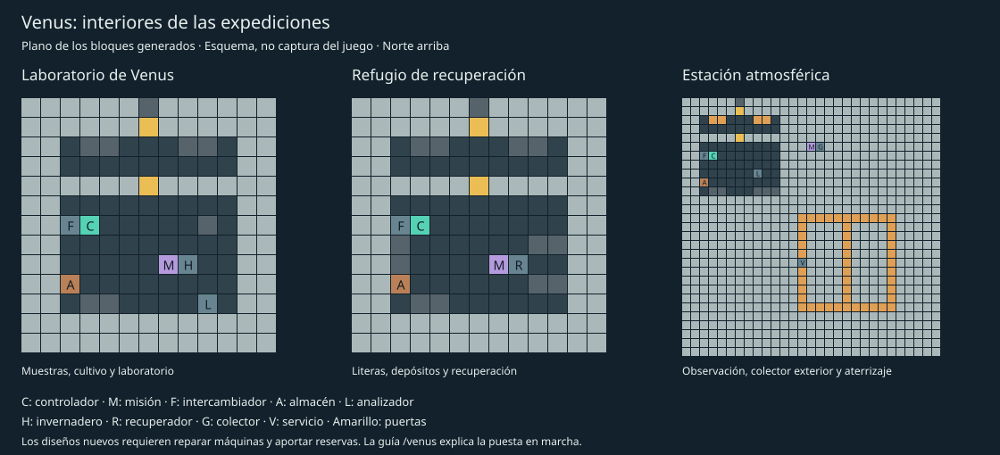

# Progresión e interiores de Venus — 0.41.0

Esta entrega desarrolla el balance de recursos, la guía de llegada y los interiores
de las tres instalaciones de expedición. Usa Minecraft 26.1, Java 25, Fabric y
Fabric API. Actualiza cliente y servidor a la misma versión y sustituye el JAR
anterior. Las colonias existentes conservan sus máquinas, recetas e inventarios.

## Balance y preparación

- **El generador geotérmico devuelve su bombona de agua llena.** Procesa batería
  vacía y agua en cinco segundos sobre lava; entrega batería cargada y el mismo
  volumen de agua en la casilla 7. Es un circuito de transferencia de calor,
  alimentado por la fuente caliente. Agua y batería siguen siendo objetos físicos.
  Una interfaz puede devolver el agua al depósito para recircularla. Una salida
  llena o la ausencia de lava detienen el lote sin consumir las entradas.
- **Compuesto con hierro común:** en el horno cerámico, cerámica + batería +
  **dos lingotes de hierro** producen una placa y devuelven la batería vacía en
  **20 segundos**. La ruta anterior con **un trozo de hierro denso** se conserva y
  tarda **15 segundos**. El horno sigue necesitando lava debajo. Puedes llevar
  hierro del Overworld sin hacer primero una expedición a Mercurio.
- **El navegador se fabrica antes del viaje:** su receta usa una tarjeta de datos
  en lugar del informe venusiano. Conserva cobre, redstone, papel y brújula.
  Los navegadores ya fabricados siguen funcionando. K muestra las recetas de
  proceso y ambas alternativas para fabricar placas.

No se han rebajado la presión, la temperatura ni la exposición mortal sin traje.
Tampoco se ha convertido el recuperador en una fuente ilimitada de oxígeno: sigue
recuperando como máximo la mitad del oxígeno respirado y necesita filtros y energía.

### Calcular reservas

Usa `/venus recursos 15 2 75`: los números son **minutos de juego, ocupantes y
volumen de aire**. Para una habitación de 75 bloques, dos personas y 15 minutos
a 20 TPS, el mínimo de soporte vital es:

| Reserva | Objetos llenos |
|---|---:|
| Oxígeno | 1 bombona |
| Energía | 6 baterías |
| Agua para el controlador | 2 bombonas |

El cálculo comparte costes con el controlador: una unidad de O₂ por persona y
segundo, 15 de energía y 5 de refrigeración por segundo, y dos unidades de O₂ por
bloque para la primera presurización. Cada objeto lleno aporta 2.400 unidades al
controlador. Los números representan unidades de juego, no volúmenes físicos reales.

Es un **mínimo local**, con reposición manual o automática al agotarse las reservas.
La capacidad interna es limitada: no implica que todos los objetos quepan a la vez.
Trajes, vehículos, procesadores, intercambiadores, mantenimiento y pérdidas por
fugas requieren suministros adicionales. La estimación tampoco garantiza que el
presupuesto térmico de una fábrica completa sea suficiente. Admite de 1 a 240
minutos, de 1 a 16 personas y hasta 512 bloques de aire. A menos TPS tardará más
tiempo de reloj; el consumo avanza con los ticks.

## Guía de llegada

Al entrar vivo en Venus aparece una indicación en el chat una sola vez por jugador
y mundo. Haz clic en ella o escribe `/venus`. No abre una pantalla durante el vuelo,
no pausa el mundo y no otorga inmunidad. `/venus guia` muestra las instrucciones
completas, incluso antes de viajar. El diario del navegador incluye estas páginas.

| Etapa | Qué observa el servidor |
|---|---|
| Llegada | Estar vivo en Venus, sin ser espectador |
| Refugio | Estar dentro de una habitación realmente protegida por su controlador |
| Energía | Generador geotérmico a 16 bloques o menos con un lote completado |
| Refrigeración | Intercambiador a 16 bloques o menos con refrigerante interno cargado |
| Automatización | Máquina próxima con interfaz habilitada en estado de abastecimiento operativo |
| Alimentos | Invernadero próximo cuyo último lote terminado es trigo hidropónico |
| Expedición | Haber reclamado una de las tres expediciones naturales |

La revisión ocurre una vez por segundo y solo usa equipos cargados. No busca
estructuras remotas ni solicita chunks. Para alimentos, observa el equipo antes
de terminar otro tipo de receta; los lotes anteriores a 0.41 no guardaban el tipo
terminado y necesitan una nueva cosecha para esa observación.

El progreso y los avances de la pestaña **Llegar a Venus** se guardan por UUID.
Las etapas pueden observarse en otro orden y el diario señala la primera pendiente.
En una colonia compartida puedes aprender observando equipos ajenos: esto no es
un sistema de propiedad ni una prueba de que hayas fabricado personalmente cada
máquina. La expedición sí utiliza tu registro personal de recompensas. No hay
premios de objetos ni bloqueos tecnológicos asociados al tutorial. Reconectar o
cambiar de dimensión no reinicia sus marcas ni repite el aviso de bienvenida.

Una vez completada la guía, siguen siendo necesarias las revisiones periódicas:
las etapas son historia de aprendizaje, no un certificado permanente de seguridad.

## Interiores de las expediciones

Los nuevos diseños mantienen los identificadores y las frecuencias de aparición.
Solo afectan a instalaciones generadas en **chunks nuevos**. No se sustituyen
edificios guardados ni se llenan almacenes de bases existentes.

Las salas principales ahora tienen una envolvente de 11 × 6 × 11 bloques y un
vestíbulo separado del área habitable. Se conservan parcelas de superficie de
13 × 13 bloques y la cubierta atmosférica de 29 × 29 en Y=300. El límite de volumen
del controlador sigue siendo 512; los interiores quedan dentro de ese límite.

- **Laboratorio de Venus:** banco de muestras, analizador, módulo hidropónico,
  mesa de trabajo, iluminación de cultivo y un cofre con semillas, envases vacíos
  y tarjeta. La consola sigue adyacente al invernadero que debes recuperar.
- **Refugio de recuperación:** literas decorativas, depósitos vacíos, reciclador,
  mesa y repuestos limitados. Las literas están hechas con cojines y losas:
  no son camas vanilla que puedan explotar ni cambian el punto de reaparición.
- **Estación atmosférica:** mesa de observación, analizador interior, colector y
  consola en una zona exterior despejada, y marcas de aterrizaje a ras de cubierta.
  La estación de servicio permanece apagada inicialmente. Una única batería y
  envases de investigación forman su pequeño almacén de recuperación.

Cada instalación incorpora un intercambiador parcialmente averiado junto al
controlador. No tiene carga. Las máquinas de misión siguen averiadas y no se
inventa una reserva de vida: debes reparar y aportar suministros. El refugio
conserva sus 4.800 unidades iniciales de residuos recuperables, como en 0.39.
Los cofres usan tablas de botín de Minecraft: se resuelven una vez al abrirlos,
no son generadores periódicos de materiales.

### Utilizar el vestíbulo

Las dos puertas de esclusa tienen mitades y orientación nativas, con botones a
ambos lados. Pulsa el botón exterior, entra al vestíbulo y espera a que cierre;
después abre la puerta interior. **No existe un enclavamiento automático** que
impida abrir las dos puertas al mismo tiempo. Abrir ambas comunica el área habitable
con el exterior y hace perder el sellado. La puerta interior cerrada permite
mantener aislada la sala mientras la exterior está abierta.

El vestíbulo no incorpora un segundo controlador: permanece expuesto cuando se
abre al exterior. Lleva el traje durante el tránsito. Una habitación cerrada sin
O₂, energía o agua tampoco protege a los ocupantes.

## Comprobaciones y límites

Las pruebas automáticas cubren el cálculo contra el consumo real del soporte,
100 lotes geotérmicos con una sola bombona recirculada, conservación de baterías,
salidas bloqueadas, ausencia de calor, guardado de un compuesto a mitad de lote,
progreso por UUID y avances sin premios de objetos. Los diseños se interpretan
con plantillas y estados nativos; el escáner comprueba el sellado con una puerta
abierta y la fuga al abrir ambas. Se conservan las pruebas de generación en tres
semillas y las simulaciones de componentes de cuatro horas anteriores.

No se ha ejecutado una partida gráfica ni una sesión multijugador para esta
entrega. Quedan por observar en Minecraft la interacción real con botones/puertas,
avisos y páginas de la guía, la lectura de los interiores, las conexiones completas
y el ritmo de una partida de supervivencia. Las comprobaciones automáticas no
sustituyen esa prueba de juego. [Lista de verificación](venus-colony-playtest.md).
